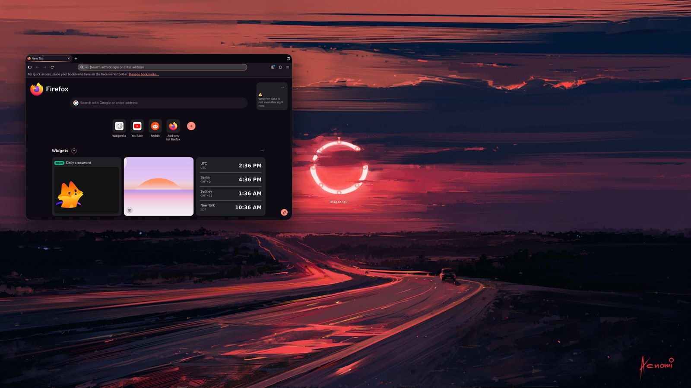
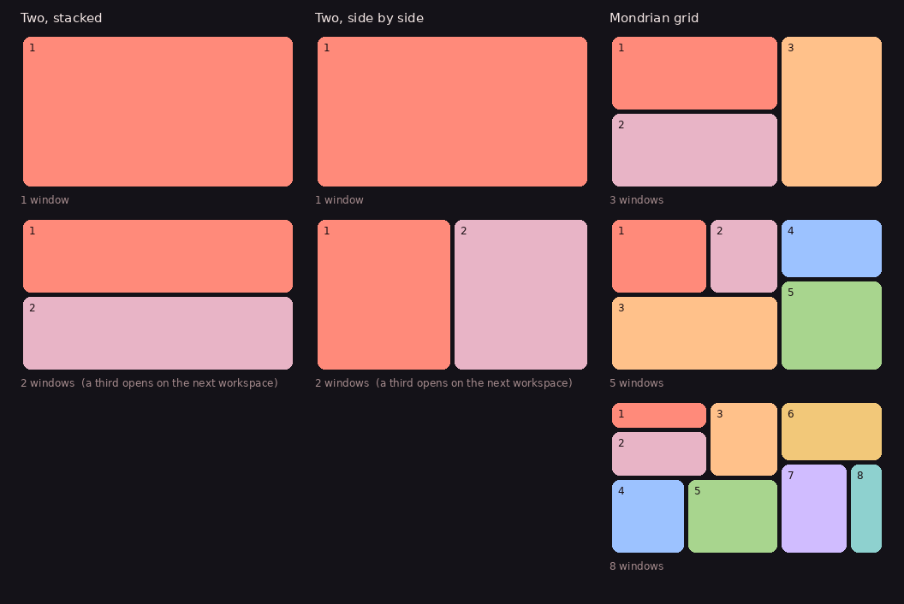
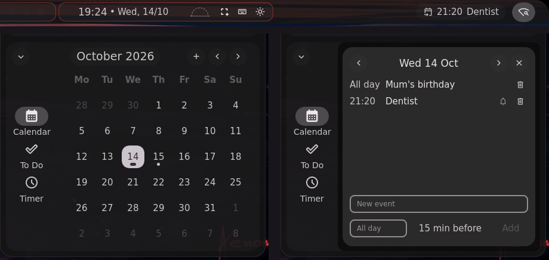

# Halcyon

A Hyprland desktop built on [end-4's dots-hyprland](https://github.com/end-4/dots-hyprland)
(illogical-impulse), with a small layer of our own on top.

The earlier Halcyon was a desktop written from scratch: a Python theme
generator, its own Quickshell shell and its own installer. It broke, so
this repository now starts from end-4's desktop, which is maintained and
known to work, and keeps Halcyon's own changes in one place on top of it.



<sub>The Red Sun theme. Previews in this README are rendered from the repository: each theme's wallpaper, its
revolver drawn by the shell's own QML, and a real Firefox wearing the theme, composited together. The bar and the
other parts of the live desktop are not in them.</sub>

---

Documentation is in [docs/](docs/README.md): the Halcyon pages, and the illogical-impulse pages ported from end-4's docs.

## What you get

Everything illogical-impulse provides: the Quickshell bar and sidebars,
overview, search, notifications, lock screen, on-screen keyboard, AI
sidebar, Material You colours taken from your wallpaper, and the
installer for Arch, Fedora, Gentoo and Nix. See the
[illogical-impulse docs](https://ii.clsty.link) for all of it. Those docs
apply here unchanged.

On top of that, Halcyon adds:

| | |
|---|---|
| **Glass panels** | Shell transparency is on by default. It can still be turned off in Settings. |
| **Softer layout** | Wider gaps, rounder corners, deeper blur (popups too), a softer shadow. |
| **Wallpapers** | The hyperNeo fire wallpaper is the default. It and the three Halcyon wallpapers are copied into `~/Pictures/Wallpapers`, where the wallpaper picker looks. |
| **Themes** | Five hand-made themes: HyperNeo, Star Rail, Shattered Glass, Fractured Glass and Red Sun. [More below.](#themes) |
| **Voice assistant** | Press `Super + Shift + Space` and speak. It answers aloud and can run the desktop. [More below.](#voice-assistant) |
| **Browser themes** | Firefox and Chromium take the desktop's colours, from a theme or the wallpaper. [More below.](#browsers) |
| **Server mode** | One button in **Settings > Halcyon**: no suspend, no automatic lock or screen blanking, until you stop it. [More below.](#server-mode) |
| **Keybinds** | Extra shortcuts, listed below. They only use key combinations upstream leaves free. |
| **hyprland-plus** | The compositor is [hyprland-plus](https://github.com/trail-b1az3r/hyprland-plus): Hyprland 0.56.2 with mini windows, superposition windows, plustile windows and a drag fix. [More below.](#hyprland-plus) |

## Install

```sh
git clone --recursive https://github.com/trail-b1az3r/dots.git halcyon
cd halcyon
./setup install
```

`--recursive` matters. The shell's shape widgets are a git submodule, and
without them Quickshell fails to load. If you already cloned without it:

```sh
git submodule update --init --recursive
```

Useful options (`./setup install -h` lists all of them):

| Option | Effect |
|---|---|
| `--skip-alldeps` | Only copy config. Don't install packages. |
| `--skip-wallpapers` | Don't copy wallpapers into `~/Pictures/Wallpapers`. |
| `--core` | Only Hyprland and Quickshell. Skip fish, fontconfig, misc app config and wallpapers. |

When logging in from a display manager, choose **Hyprland**, not
*Hyprland (uwsm)*.

### Updates

Halcyon checks the repository for new commits every hour, and a couple of minutes after you log in. When there are
some, you get a notification with an **Update now** button, and the bar shows a download icon with the number
waiting. Click it, or the sidebar's **Update Halcyon** button, to update: only the files that changed are copied,
and only what they change is reloaded. Files it replaces are backed up under `~/.local/state/halcyon/backups`.

It follows `main`, whatever your clone is on: another branch, a detached checkout, or a release archive (which
becomes a git clone on its first update). Edits you made inside the clone are put aside and back. If an update
fails, the notification and the bar say why.

```sh
~/.config/hypr/hyprland/halcyon/update status   # what is installed, what is waiting, the last problem
~/.config/hypr/hyprland/halcyon/update apply    # update now
halcyon doctor                                  # updates, the revolver, the browser themes and the Wi-Fi, in one report
halcyon doctor --fix                            # and fix what can be fixed from there
```

### Automatic install, step by step

`./setup walkthrough` is the install with the steps shown as it goes. It lists the eight steps, asks once
whether to start, and then installs with no more questions. Each step prints `Step n of 8` as it runs.

The hyprland-plus step is automatic too. The screen switches to its own console, builds there, and switches
back to your desktop when it is done. Your sudo password is asked once in the terminal, and again on that
console, because sudo does not share its password across consoles. `./setup walkthrough -f` skips the question.

The switch back uses the console your session runs on (`XDG_VTNR`). If that is not set, it uses `fgconsole`.
If neither works, the installer says so and you switch back with Ctrl+Alt+F1 to F6.

`./setup uninstall` removes what the installer put in place.

## hyprland-plus

[hyprland-plus](https://github.com/trail-b1az3r/hyprland-plus) is Hyprland 0.56.2 with the
Halcyon additions. Its own README describes each one. The desktop uses:

- **Mini windows**, `SUPER + CTRL + N`: a window shrinks to a small floating tile. See [Mini windows](#mini-windows).
- **Superposition windows**: Spotify stays on a thin strip at the right edge, above a fullscreen window.
- **Plus Tiles**: terminals are ordinary tiles until you use Move Edge (`SUPER + ALT + E`) on one. Then you pick an
  edge, move it, see the preview and press Enter: the tiles sharing that edge adapt, and the tile keeps its custom
  size from then on. See [Plus Tiles](#plus-tiles) below.
- **Drag fix**: a tiled window keeps the grab point when it floats during a drag, so it does not jump.
  The drag guide tints the tile a dropped window would swap with.

The settings are in `~/.config/hypr/hyprland/halcyon/plus.lua`. They only take effect with the fork.

hyprland-plus is not a command. It is Hyprland itself, built with the Halcyon additions, and it takes the place of
the `Hyprland` program. After installing it, log out and back in and start Hyprland as you always do. To check, run
`halcyon hyprland`, which says whether you run stock Hyprland, hyprland-plus, or a hyprland-plus built before Plus
Tiles (that one still has mini windows and the superposition strip; `sudo hyprctl-lite install update` updates it).
`hyprctl version` says `hyprland-plus` too. (`hyprctl dots plus` below uses `plus` as the name of a dot set, not a
command.)

On Arch, `./setup install` looks for hyprland-plus however it was installed: the AUR package (see `packaging/aur`
in the fork), or a build in `/usr/local` from hyprctl-lite or an earlier install. A build that is already up to date
is not built again; one behind its branch is updated. Otherwise the installer builds the fork on a text console of its
own and installs it to `/usr/local`, ahead of any packaged Hyprland in PATH. Set `HALCYON_SKIP_HYPRLAND_PLUS=1` to
skip that, or `HALCYON_REBUILD_HYPRLAND_PLUS=1` to rebuild anyway.

You do not need the stock `hyprland` package. pacman does not know about `/usr/local`, so when nothing in pacman
provides `hyprland`, the installer (and hyprctl-lite) adds a small empty package, `hyprland-plus-local`, that does.
Packages that depend on Hyprland, like `illogical-impulse-hyprland`, are then satisfied by the fork, and the stock
package is never pulled in beside it. `sudo pacman -R hyprland-plus-local` takes it away again.

Once hyprland-plus is running, `hyprctl dots plus` shows the dots checkout the installer recorded.
`hyprctl dots plus --install` runs `./setup install --force` in that checkout, without asking questions and without
building hyprland-plus again.

The same command installs other people's Hyprland dotfiles, and the base that Halcyon is built on. Run it in a terminal, because their installers ask questions:

| Command | Set | Installer |
|---|---|---|
| `hyprctl dots ii --install` | [illogical-impulse](https://github.com/end-4/dots-hyprland), end-4's desktop that Halcyon is built on | its `./setup install` |
| `hyprctl dots jakoolit --install` | [JaKooLit Hyprland-Dots](https://github.com/JaKooLit/Hyprland-Dots) | its `copy.sh` |
| `hyprctl dots mlfw --install` | [ML4W OS](https://github.com/mylinuxforwork/dotfiles) | ML4W's installer from ml4w.com |
| `hyprctl dots gdots --install` | [gdots](https://github.com/semi710/gdots) | copies its `.config` and `bin` |

`hyprctl dots <set>` without `--install` only describes what it would do. With `--install`, the set is cloned to
`~/.local/share/halcyon/dotsets/<set>` and left as it is upstream. Then the config it replaces is backed up to
`~/.local/state/halcyon/backups/<set>-<time>`, and its installer runs. Each set replaces the desktop's config in
`~/.config`, so `hyprctl dots plus --install` brings Halcyon back. Restore anything else from the backup by copying
it back by hand.

The ML4W installer also installs packages, and gdots does not install the packages its README lists. JaKooLit's
repository says it was archived in March 2026 and is now maintained at
[LinuxBeginnings/Hyprland-Dots](https://github.com/LinuxBeginnings/Hyprland-Dots).

### Saving and loading dots

`hyprctl store` saves the dot files as a `.dhyprsave` file, and `hyprctl load` loads one back:

| Command | Does |
|---|---|
| `hyprctl store -n <name>` | Saves the dot files as `~/.local/share/halcyon/saves/<name>.dhyprsave` (`hyprctl save` does the same) |
| `hyprctl load -l` | Lists the saves. The one in use is marked `(active)` |
| `hyprctl load -n <name>` | Loads a save |
| `hyprctl load -a` | Loads the save before the latest switch, so running it again goes back |
| `sudo hyprctl load ...` | The same, but for the user who ran `sudo`, not root |

A `.dhyprsave` is a gzipped tar. It holds the entries of `~/.config` that the dot sets install, as they are now.
It also holds the `.local` files the config refers to: scripts in `~/.local/bin`, fonts, icons and themes, and the
Halcyon state files (`theme.lua`, `placement.lua`, `games.lua`, the active save) and the shell's own settings in
`~/.local/state/quickshell/user`. Nothing else in `~/.local` is saved. Its `manifest.txt` lists what it holds, and
`store` prints how many files and how much it saved. Entries that are links (as the installer makes them) are saved
as the files they point to; before 0.56.2.p2 only the links were, so a save came out at about 10 KB. `store` warns
when a save holds fewer than 50 files.

Loading first backs up the files it replaces to `~/.local/state/halcyon/backups/before-load-<time>`. Each dot set
install, and each `hyprctl dots plus --install`, stores the dots it switched to, so `load -a` has something to go
back to. The first switch also stores the Halcyon desktop it replaces. Those automatic saves take disk space.

## Install or update hyprland-plus with hyprctl-lite

hyprctl-lite is a single script with two commands: `install full` installs or updates hyprland-plus, then removes
itself, and `install update` updates an installed hyprland-plus and stays for next time. On Arch, get it with this one
command:

```sh
curl -fsSL https://raw.githubusercontent.com/trail-b1az3r/dots/claude/youthful-gates-rt1csq-v2/tools/hyprctl-lite/hyprctl-lite | sudo tee /usr/local/bin/hyprctl-lite >/dev/null && sudo chmod 755 /usr/local/bin/hyprctl-lite
```

Then run:

```sh
sudo hyprctl-lite install full
```

It clones hyprland-plus into `~/hyprland-plus` (or updates that clone), installs the build dependencies from its
`packaging/aur/PKGBUILD`, builds it as your user, and installs it to `/usr/local`. It keeps the packaged Hyprland as
`/usr/bin/hyprland.official`. If a step fails, it stays in `/usr/local/bin` so you can run it again.

To update later:

```sh
hyprctl-lite install update --check   # is there an update? (no sudo; exit 0 up to date, 10 an update is waiting)
sudo hyprctl-lite install update      # get it
```

`install update` checks that hyprland-plus is installed in `/usr/local` (one from the AUR is updated by your AUR
helper), pulls `~/hyprland-plus`, and stops there when the installed build is already that commit. Otherwise it lists
the new commits, installs only build dependencies that are missing, builds and installs. hyprctl-lite stays in
`/usr/local/bin`, so the next update is the same command. `--force` builds again even when nothing changed.

The `curl` command runs a script from GitHub as root, so read it first if you prefer:
`curl -fsSL <the same URL> | less`. The script is short.

## Releases

Two kinds of release are on the repository's Releases page. GitHub Actions builds both.

- **Stable** (`.github/workflows/stable.yml`): a normal release, numbered by the `VERSION` file. It is published
  when a `v` tag matching `VERSION` is pushed, or when you run it by hand: **Actions > Stable release > Run
  workflow**, on `main`. Leave the version empty to release what `VERSION` says; the `v` tag is made for you if it
  isn't there yet.
- **Nightly** (`.github/workflows/nightly.yml`): a prerelease built from `main` each night. It replaces the previous
  nightly. If `main` has not changed since the last one, the run stops without building.

Each archive is `halcyon-<version>.tar.gz` with a `.sha256` file next to it. Check a download with
`sha256sum -c halcyon-<version>.tar.gz.sha256`.

To make a stable release, change `VERSION`, push it, and run **Stable release** from the Actions tab. Or tag it
yourself:

```sh
echo 1.0.1 > VERSION
git commit -am "Release 1.0.1"
git tag v1.0.1
git push origin main v1.0.1
```

`scripts/release.sh <label> <outdir>` builds the same archive on your machine, if you want to look at it first.

## Themes

By default, colours come from your wallpaper, as in upstream. A theme
replaces that with a palette designed by hand, plus its own window
style, animations, wallpaper and, for some, shell layout and effects:

| Theme | Id | Look |
|---|---|---|
| **HyperNeo** | `hyperneo` | macOS-style, in ember and neon on near-black. A menu bar and a dock, squircle windows with deep soft shadows, springy animations, rounded screen corners. |
| **Star Rail** | `hsr` | Astral gold and lavender on deep-space navy, over a golden rail curving through a nebula. Can show the current banner character. |
| **Shattered Glass** | `shattered-glass` | Liquid glass: a glass lens follows the pointer, clicks crack the screen, windows turn to frosted glass. Ice blue and prism violet, sharp corners. |
| **Fractured Glass** | `fractured-glass` | Refraction only, like Apple's Liquid Glass: a squircle glass lens follows the pointer and bends what's behind its rim. No ripples or cracks. Soft blue, lavender and pink over calm fragments of thick glass. |
| **Red Sun** | `red-sun` | A road at sunset under a red ring. Rose and ember accents over deep dusk violet, rounded windows with warm shadows. The ring is the revolver: spin it and the screen breaks, an eye opens in the sun and finds the car, and the tape rewinds. Wallpaper: *Eclipse* by Alena Aenami (2017), from [wallhaven](https://wallhaven.vip/w/yjl8mk); [buy it here](https://www.artstation.com/marketplace/p/oAol/wallpaper-pack-02). |
| **After ICEY** | `after-icey` | Silver hair, cyan light and ink-dark navy, over the animated *After ICEY* wallpaper (fan art, by way of [MotionBGs](https://motionbgs.com/after-icey)). `halcyon wallpapers get after-icey` fetches it. |
| **Manga Ink** | `manga-ink` | Black ink on paper with a blush accent, over the animated *Anime Girl x Cat* wallpaper by fw_storm ([DesktopHut](https://www.desktophut.com/anime-girl-x-cat-pl2s)). The site gives the file out from its page: download it there, then `halcyon wallpapers import anime-girl-cat FILE`. |


<sub>Top: HyperNeo, Star Rail. Bottom: Shattered Glass, Fractured Glass.</sub>

Pick one in **Settings > Halcyon**, with **`Ctrl + Super + Shift + T`**,
or from a terminal:

```sh
halcyon list
halcyon apply shattered-glass
halcyon off        # back to wallpaper colours
halcyon help       # everything else
```

`halcyon` is an alias in fish and zsh, and a link in `~/.local/bin`
(created when Hyprland starts) for other shells. Open a new terminal
after installing. Until then, the full path is
`~/.config/hypr/hyprland/halcyon/halcyon-theme`.

Applying prints one line. Output from upstream's colour scripts goes to
`~/.local/state/halcyon/apply.log` instead. On Hyprland that log
includes a traceback from end-4's KDE colour syncer
(kde-material-you-colors) about KWin not running. It's harmless: KWin is
KDE's compositor, and Hyprland is doing that job instead.

A theme recolours everything, not just the bar:

- **Shell:** its palette goes straight into the Quickshell colours.
- **Terminals:** its own 16-colour palette.
- **GTK, Qt/KDE, fuzzel and the lock screen:** generated from the theme's
  seed colour through upstream's own pipeline.
- **Windows:** gaps, corners, borders, blur, shadows and animations.
- **Shell layout:** some themes change shell settings too. HyperNeo turns
  on the dock and restyles the bar, and Shattered Glass makes panels more
  see-through. These are put back when you leave the theme, except any
  you changed yourself in the meantime.

Picking another wallpaper leaves the theme, and colours follow the new
wallpaper. The themes are dark themes, so switching to light mode, or
picking an accent colour, also leaves the theme. The colours are then
generated from the theme's accent, not hand-made. `halcyon off`
makes colours follow the wallpaper again.

### Applying a theme on a schedule

In Settings > Halcyon, open a theme's menu and choose **Auto-apply**. A theme can
come on at a clock time, at **sunset** or **sunrise** (with an offset, such as
30 minutes before sunset), on some days only, or with some weather. Wallpaper
Heaven suits sunset.

The sun times are worked out on this computer each day, for your location: the
one you type in the Auto-apply card, or else the bar's weather location. Where
the sun doesn't set that day, a sunset schedule doesn't fire.

```sh
halcyon auto list                   # what is scheduled, and today's sun times
halcyon auto sun                    # today's sunrise and sunset
halcyon auto location 51.51,-0.13   # set the location (clear: back to the weather's)
```

The **sun dial** in the bar, beside the clock, shows where the sun is in today's sky. Hover it for sunrise,
sunset, the length of the day and the next theme change your schedules will make ("Red Sun, today at 19:12 (30 min
before sunset), in 2 h 10 min"); click it to open Settings. `bar.sunDial: false` in the shell config hides it, and
`halcyon auto day` prints the same in a terminal. In the Halcyon themes the bar's groups are also edged in the
theme's own light: ember in Red Sun, gold in Star Rail, frost in the glass themes.

### Effects

| Level | What you get |
|---|---|
| `full` | Everything, including screen shaders. The glass themes' default. |
| `light` | No screen shader. Glass materials, translucent windows and animations stay. The other themes' default. |
| `off` | Plain blur, opaque windows, no native glass, stock animations. |

Set the level in **Settings > Halcyon > Effects**, from the
`Ctrl + Super + Shift + T` menu, or with:

```sh
halcyon effects light      # or full / off; sticks across themes
halcyon effects default    # back to each theme's own default
```

**Settings > Halcyon > Glass** tunes the glass. Changes apply to the
active theme straight away:

| Setting | Default | What it does |
|---|---|---|
| Pointer lens | on | The glass lens that follows the pointer (Full only) |
| Click ripples | on | A soft ripple and faint cracks where you click (Full only) |
| Colour fringe at screen edges | off | Slight colour split at the edges (Full only) |
| Strength | 0.5 | Scales all the screen effects; 0 turns them to nothing |
| Lens size | 90 px | Radius of the pointer lens |
| Lens bounce | 0.6 | How much the lens squashes and springs back; 0 turns it off |
| Focused / other windows | 0.96 / 0.9 | Opacity of glass windows (Light and Full) |
| Frost | 8 | Blur size behind glass windows |

They're stored under `halcyon` in `~/.config/illogical-impulse/config.json`,
which `halcyon refresh` re-reads.

**Red Sun at `full`**: the red ring in the wallpaper is the revolver. It sits on the painted ring, lights up while it
turns, and a real spin plays about ten seconds (`themes/shaders/red-sun.frag`):

1. **The sun spins.** The ring turns, gaps and all, with embers flying off it. Cracks run out from it and the screen
   splits into bevelled shards that sink towards it, the gaps glowing red, light raying out.
2. **An eye opens** in the hole inside the ring. It looks round, blinks, then fixes on the car on the road: its
   pupil narrows to a slit and a red ring closes on the car.
3. **It turns to videotape**: scanlines, colour bleeding sideways, tracking noise, and a VCR's `PLAY ▶` with a counter.
4. **It rewinds**: `◀◀ REW`, and everything runs backwards at speed until the desktop is as it was.

A slow nudge does nothing. The shader is only switched in for those seconds (`halcyon collapse arm`, run by the
revolver), so Red Sun costs no GPU the rest of the time. At `light` or `off` the ring still turns, without the
sequence. The revolver is on in every theme (`halcyon revolver on|off`, or Settings > Revolver), and glows on the
ring even at rest so you can find it; `halcyon revolver status` says why if it doesn't show.

Settings > Revolver > Red Sun sequence turns the parts on and off: the whole sequence, the eye, and the videotape and
rewind (without it, the broken screen fades back on its own after about seven seconds). **Quality** set to `Light`
drops the bevels, light rays and embers and takes one sample of the screen per pixel instead of several, for weaker
GPUs. At `Full` a frame now costs about half what it used to.


<sub>Rendered frame by frame from the shader itself.</sub>


### The revolver, the clock and the weather card

The wallpaper widgets take the active theme's shapes. The revolver's drum is a Material cookie dial with no theme,
the red ring in Red Sun, a cut-glass disc with gem chambers in the glass themes, a squircle with icon-like chambers in
HyperNeo, and a gold rail with star chambers in Star Rail. The analogue clock's face and the weather card follow the
same shapes. Drag the drum to spin it: a flick fires the game under the hammer, a nudge only settles it.

When a spin starts a game, a shot leaves the drum, a shockwave hits the middle of the screen, and the game's Steam
art spins in like a chamber turning into place, with its name typed out under LOADING. It goes when the game's window
opens (at most nine seconds), takes no clicks or keys, and Settings > Revolver > Launch animation turns it off.
**Preview** there plays it without starting anything (`qs -c ii ipc call revolver preview`).


### More desktop widgets

Settings > Background has a section for each. They are all off until you turn them on, and each one can be dragged
or placed in the least or most busy part of the wallpaper.

- **Audio visualizer**: the spectrum of what is playing, from cava (already a dependency), in the theme's two accent
  colours. Four styles: bars, mirror, wave and ring. It can sit on a card in the theme's shape, fade out while
  nothing plays, and takes the number of bars and the frame rate (30 by default; cava only runs while the widget is
  shown, and one cava serves everything that draws a spectrum).
  **As a window (superposition)** shows it as a window instead: with hyprland-plus the rule on its title
  (`app_rules.lua`) keeps it tiled on the thin screen-edge strip. The strip waits behind a fullscreen window unless
  Settings > Halcyon > Plus Tiles > **Music strip over fullscreen** is on. On stock Hyprland it is an ordinary
  window. Close the window to turn the widget off.
- **System**: processor, memory and swap on a card in the theme's shape.
- **Now playing**: the cover, title and artist of the active player, how far along it is, and previous, play/pause
  and next. It fades away when no player is running.
- **Lyrics**: the words of the song that is playing, a few lines at a time, the one being sung large. They come from
  [LRCLIB](https://lrclib.net) (free, no account): the artist, title and length are sent once per song, and only
  while the widget is on.

Each theme draws these widgets its own way, not only their cards:

| Theme | Gauges | Spectrum bars | Progress | Lyric being sung |
|---|---|---|---|---|
| No theme | rings | rounded | a line | in the accent colour |
| Red Sun | thin lit rings with their glow, labels in capitals | needles with lit tips | a lit line | lit like the ring |
| Shattered / Fractured Glass | rings of facets | sharp shards with a bright edge | facets | on a pane of frost |
| HyperNeo | three activity rings inside each other, with a legend | pills | a thick pill | heavy and large |
| Star Rail | gold rails with star ticks | bars topped with a diamond | a fine rail with a diamond on it | between two stars |
| After ICEY, Manga Ink | keycaps that fill from the bottom | stacked keys, like a console's equaliser | a row of keys | on a keycap |

The clock's hands and the weather card take the same colours.

Settings > Background > Wallpaper: an animated wallpaper (mpvpaper) rests while the screen is locked or a fullscreen
window covers every monitor, and carries on from the same frame. cava stops while the screen is locked.

**Shattered Glass at `full`** runs a screen shader
(`themes/shaders/shattered-glass.frag`) that treats the screen as a
pane of glass:

- **Pointer lens:** a liquid-glass lens follows the pointer. Its middle
  stays clear; light bends in its rounded rim, which catches a soft
  highlight on top and a faint shadow below. It fades when the pointer
  rests.
- **Click ripples:** each click sends a gentle ripple through the glass,
  with faint cracks around the click that heal as it passes.
- **Edges (off by default):** the screen's edges split colour slightly,
  as thick glass does.

Mouse effects need Hyprland's damage tracking off, so the screen is
redrawn every frame. That uses much more GPU than normal, so use `light`
on battery. The shader needs Hyprland 0.56 or newer. It has been
compile-checked and rendered offline, but not yet tried on a real
display. If the lens looks mirrored vertically,
`halcyon effects flip` fixes it.

**Fractured Glass at `full`** runs `themes/shaders/liquid-glass.frag`: a
lens shaped and lit like Apple's Liquid Glass controls. It is a squircle,
with an almost untouched middle and a rounded bezel that bends light more
and more towards the edge, so content wraps around the rim. The rim
catches light facing the top-left, with a dimmer reflection opposite and
a little colour in the inner bezel. The glass lifts saturation slightly
and sits on a soft shadow. Nothing reacts to clicks. Strength and lens
size come from Settings > Halcyon > Glass, like Shattered Glass; the
ripple and edge-fringe switches don't apply to it.

**Native glass.** Hyprland's development version, which comes after
0.56, adds built-in glass blur materials. When yours has them, HyperNeo and Shattered Glass switch to
the `acrylic` material automatically, which gives a curved, refracting
glass edge like macOS's Liquid Glass. On 0.56 they use tuned regular
blur instead.

**HyperNeo** has no traffic-light window buttons. Hyprland only draws
those through the hyprbars plugin, which isn't set up here.

**Lens bounce.** Both glass lenses are a little springy:
- **While moving:** the lens is pressed slightly flatter and quivers.
- **When the pointer stops:** it springs back past its rest shape, trading
  width for height a couple of times, then settles in about half a second.

Hyprland gives screen shaders the time since the pointer last moved, but
not its speed or direction, so the bounce follows that timing. It doesn't
lean into the direction of travel.

### Cursor

Halcyon has its own cursor, **Halcyon Glass**. It matches the glass
themes: a dark glass body, a white outline, a blue-to-lavender glint
inside the rim, and a soft shadow. There are 24 shapes (arrow, hand,
text, resize arrows, grab, zoom, and more), with an animated spinner for
busy and progress, covering 117 cursor names in all. It ships in both
formats: XCursor for X11/XWayland and GTK apps, and hyprcursor for
Hyprland itself.

It's on by default and follows any theme, including wallpaper colours.
Turn it off, or change its size, in **Settings > Halcyon > Cursor**, or:

```sh
halcyon cursor off        # back to illogical-impulse's Bibata cursor
halcyon cursor size 32
```

Every shape is drawn from scratch in `scripts/make-cursors.py`, which
rebuilds the theme into `dots/.local/share/icons/Halcyon-Glass`
(it needs cairosvg and Pillow).

### Banners (Star Rail)

The Star Rail theme can show a character on its wallpaper, in a
gacha-banner layout: the character on the right inside a gold frame, and
their name lower left. Point it at art you've saved:

```sh
halcyon banner hsr ~/Pictures/aventurine.png --title "Aventurine"
halcyon banner hsr ~/Pictures/pearl.jpg --title "Pearl" --subtitle "Version 4.6"
halcyon banner hsr --clear
```

- **Cut-out art:** a character with a transparent background stands full
  height on the right.
- **Full splash image:** it fills the right half and fades into the
  nebula.

If Star Rail is active, the banner updates right away.

No character art ships with this repository. It belongs to HoYoverse,
so it can't be released under this repo's GPL licence, and the banner
changes every few weeks anyway. Use art you've saved yourself, for
example the official wallpapers from the game's website.

### Making your own

Copy one of `dots/.config/hypr/hyprland/halcyon/themes/*.json`, rename it
and edit it. The file name is the theme's id. It needs:

- **Shell colours:** the full set, which `halcyon check` lists if
  any are missing.
- **Terminal colours:** 16 of them.
- **Seed colour and scheme:** for the generated app colours.
- **Window settings:** as in the existing themes.
- **Wallpaper:** a path relative to `themes/`, or starting with `~`.

Optional sections, all shown in the shipped themes:

- **More window settings:** squircle power, shadow shape, window opacity,
  `curves` and `animations`.
- **`effects`:** a default level, a screen shader, native glass settings.
- **`shell_config`:** any setting from the shell's `Config.qml`, written
  as dotted keys like `"dock.enable": true`.
- **`banner`:** frame and glow colours.

`halcyon check` rejects a theme with a missing key or a malformed
value, and one where any text colour falls below WCAG AA contrast (4.5:1)
on its background. CI also checks that every `shell_config` key exists
in the shell, and that shaders compile.

The theme wallpapers are procedural and original. No game assets are
used. `scripts/make-theme-wallpapers.py` redraws them.

## Voice assistant

Press **`Super + Shift + Space`**, say what you want, and stop talking.
Halcyon answers in a notification and out loud. Press the shortcut again
to cancel. Turn on **"Hey Halcyon"** in **Settings > Halcyon > Assistant**
to start it by voice instead.

**One-time setup** (speech recognition, about 300 MB):

```sh
halcyon assistant setup            # add --wake for "Hey Halcyon", --piper for a natural voice
halcyon assistant login            # use your Claude Pro/Max plan: no API key needed
halcyon assistant doctor           # what's ready and what isn't
```

Or use an API key instead: `halcyon assistant key anthropic` (or `gemini`,
`openai`, `mistral`), or a key already entered in the AI sidebar.

### Using a Claude Pro or Max plan

Anthropic doesn't let other apps sign in with a claude.ai account or reuse
its login. The supported way to use a plan outside claude.ai is
**Claude Code**, Anthropic's own CLI, so that's what Halcyon uses.
`halcyon assistant login`, or **Sign in with Claude** in
**Settings > Halcyon > Assistant**, does the following:

1. Offers to install Claude Code with Anthropic's installer if it's
   missing (it asks first).
2. Runs Claude Code's own sign-in (`claude auth login`), which opens
   claude.ai in your browser. Halcyon never sees your login.
3. Switches the assistant to **Claude plan**.

After that, each request runs Claude Code headless (`claude -p`), locked
down so the only things it can do are Halcyon's desktop actions:

- all of its built-in tools are off: no shell, no files;
- it loads no MCP servers except Halcyon's, which serves the same
  twelve checked actions as every other provider;
- any `ANTHROPIC_API_KEY` in the environment is removed for the call, so
  your plan is what gets used.

Requests count against your plan's usage limits. The model is whatever
your plan's Claude Code uses; `halcyon assistant set model opus` picks
another.

**What happens:**

1. The microphone records until you pause (PipeWire).
2. **Whisper** turns your speech into text on this computer; the audio
   never leaves your machine.
3. The text goes to the AI you chose: **Claude on your Pro/Max plan**
   (through Claude Code), **Claude with an API key** (`claude-opus-5`),
   **Gemini**, a local **Ollama** model, or any **OpenAI-compatible**
   server. *Auto* picks an Anthropic API key if set, then your Claude
   plan, then Gemini, then Ollama. Keys are shared with end-4's AI sidebar, so one entered
   there works here too.
4. The reply appears in a notification and is spoken.

**Its voice.** Settings > Halcyon > Assistant > Voice. *Auto* uses Piper if you set it up
(`halcyon assistant setup --piper`), else an **AI voice** if a Gemini or OpenAI key is stored (Gemini's
text-to-speech, voice Kore, or OpenAI's `gpt-4o-mini-tts`, voice alloy; or any OpenAI-compatible voice server such
as a local Kokoro, which needs no key), else espeak-ng. Pick one to put it first; if it fails, the next one speaks
instead, and a notification says so. An AI voice sends the reply's text to that provider. **Read the AI sidebar's
replies** (on by default) speaks the left sidebar's answers as well, without code, links or markdown;
`Super + Shift + Space` stops it. `halcyon assistant test-voice` speaks with each voice and says why one fails, and
`halcyon assistant say TEXT` reads anything aloud.

**Piper voices.** Any Piper voice works, picked in Settings > Halcyon > Assistant > Voice > Piper voice (search by
language, name or quality, *Hear* one before choosing it) or from a terminal:

```sh
halcyon assistant voices --all en_GB          # the ones here, on Hugging Face, and in the AUR
halcyon assistant voice get en_GB-alba-medium # download from Hugging Face (rhasspy/piper-voices), checked, and use it
halcyon assistant voice aur piper-voices-en-gb  # every en_GB voice, with your AUR helper (paru or yay)
halcyon assistant voice use en_GB-vctk-medium --speaker p226   # one here; voices with several speakers take a name
halcyon assistant voice use ~/voices/mine.onnx  # a voice of your own (its .onnx.json beside it)
```

**Other local voice models.** *Kokoro* (Kokoro-82M, 54 voices in nine languages, offline): `halcyon assistant
setup --kokoro` (~340 MB), then pick a voice like `af_heart`, `bf_emma` or `am_adam`. *Your command*: any voice
program (Coqui TTS, sherpa-onnx, a script of your own) gets the reply on stdin and either plays it or writes a WAV
to stdout, which is played at your volume; it is split like a shell would, but never run through one. A local
server with OpenAI's `/audio/speech` (Kokoro-FastAPI, LocalAI) works as the AI voice with its address set, and needs
no key.

Voices are looked for in the assistant's models folder (the built-in `en_US-lessac-medium` and downloads),
`~/.local/share/piper-voices`, and `/usr/share/piper-voices` (where the AUR's `piper-voices-*` packages put theirs).

**What it can do.** Only these actions, each checked against a strict
schema before anything runs:

- open an app by name;
- set or change volume, mute speakers or the microphone, set brightness;
- control media;
- switch workspace;
- change the Halcyon theme or effects level;
- take a screenshot, lock the screen, or search the web.

It can't run commands or scripts, and nothing it says is ever given to a
shell. Turn actions off entirely with **Let it control the desktop**.

**The wake word** is spotted by a small offline Vosk model that only
knows the phrase. It keeps the microphone open while it's on, so it's
off by default.

**Settings > Halcyon > Assistant** covers the provider, wake word, spoken
replies, desktop control and recognition accuracy. Anything else:

```sh
halcyon assistant set model claude-sonnet-5   # or any model your provider offers
halcyon assistant set provider openai && halcyon assistant set endpoint http://localhost:8080/v1
halcyon assistant ask "what's on workspace 3?"  # typed, prints the reply
```

It keeps a few minutes of conversation, so follow-ups work, and logs to
`~/.local/state/halcyon/assistant.log`.

## Browsers

Firefox (and LibreWolf, Zen, Floorp, Waterfox) and Chromium (and Brave) take the desktop's colours: a theme's, or
the wallpaper's when no theme is on. They change when you apply a theme or a wallpaper, and pick it up the next
time the browser starts. Google Chrome needs the theme folder loaded once: see [Browsers](docs/halcyon/browsers.md).


Firefox gets pill tabs with a glow on the selected one, see-through toolbars over a gradient, a glowing address bar,
rounded menus, and a new tab page with the theme's wallpaper behind glass tiles. Chromium's new tab page gets the
wallpaper too, cut to the size of your largest screen so it isn't stretched.

Firefox reads its theme only when it starts, so restart it after the first one. `halcyon browsers` says when a
running Firefox still shows the old colours.

**Other sites.** How far the Firefox theme reaches into web pages is a setting (Settings > Halcyon > Browsers, or
`halcyon browsers sites off|accents|override`):

| Level | What every site gets |
|---|---|
| `off` | nothing: the new tab and Firefox's own pages only |
| `accents` (default) | the theme's accent on scrollbars, selected text, checkboxes, sliders and progress bars, the caret and the focus ring. Sites that have a dark mode use it when the theme is dark. A site that styles the same thing itself still wins. |
| `override` | the theme's background, text and link colours, as Firefox's "override the colours specified by the page" set to Always. Every site looks like the desktop, and loses the colours of its own design (a coloured note or banner goes plain). |

Leaving `override` gives sites their own colours back at the next Firefox start.

```sh
halcyon browsers                  # what is themed, and where
halcyon usb                       # why a browser can't find a USB device, and the fix
```

## Games

A game keeps the keyboard when the pointer leaves its window, on a second screen or past the edge of a window that
isn't fullscreen. Many games pause or stop drawing when they lose focus, which looks like a freeze. Click another
window to leave the game; outside games, focus follows the mouse as before. A window counts as a game when it is a Steam game
(`steam_app_*`), says it is one (content type `game`), or has the `game` tag. The top bar also leaves fullscreen
games alone when the pointer reaches it.

```sh
halcyon games focus off           # focus follows the mouse into and out of games as well
halcyon games status
```

Settings > Halcyon > Games has the same switch.

## Volume popup and drawing on the screen

Two small tools, both optional, both in the theme's colours.

**Avizo** draws the popup you get from the volume, microphone and brightness keys, in the theme's colours and with
its rounding. Settings > Halcyon > On the screen picks it over the shell's own popup, which then stays hidden.

```sh
yay -S avizo                      # once
halcyon osd avizo                 # use it (halcyon osd shell goes back)
halcyon osd test                  # show a popup now
```

The keys still change the level themselves; they then call `halcyon-osd`, which shows the new level through Avizo
and does nothing at all while the shell's popup is selected.

**Wayscriber** (called Hyprmarker before it was renamed) draws on top of anything, like ZoomIt: a pen, shapes, text, a
whiteboard, zoom. Its daemon starts at login and **Super + Shift + D** shows and hides it.

```sh
yay -S wayscriber-bin             # once
halcyon annotate                  # status
halcyon annotate off              # not at login (on turns it back on)
halcyon annotate toggle           # show or hide it, as the key does
```

Its pen palette is the theme's accent and tertiary colour and the usual pen colours leaning toward the accent, and
its status bar and help panel use the theme's surfaces. Applying a theme or a wallpaper rewrites
`~/.config/avizo/config.ini` and `~/.config/wayscriber/config.toml`, but only files that start with a
`halcyon-managed` line: a config you edited yourself is never touched. `halcyon overlays sync` does it on demand.

## Wi-Fi at login

At every Hyprland login, Halcyon gets the Wi-Fi up. It waits for the card (a Surface's Marvell card is slow to
start), unblocks the radio, takes the card back if NetworkManager left it **unmanaged**, and connects. If it can't,
a notification says why. Its log is `~/.local/state/halcyon/wifi.log`.

```sh
halcyon wifi          # what NetworkManager sees, and what stands in the way
halcyon wifi fix      # the lasting fixes, as root (asks for sudo)
halcyon wifi report   # everything above and NetworkManager's log in ~/halcyon-wifi-report.txt, to send
```

`halcyon wifi fix` does only what your machine needs. It installs NetworkManager if it is missing (the shell's
network menu uses it) and starts it at every boot. It keeps Wi-Fi cards managed by NetworkManager, whatever marked
them unmanaged. When `iwd` runs beside NetworkManager, it makes NetworkManager use iwd (`wifi.backend=iwd`) so the two
stop fighting over the card and the networks iwd knows stay known; it no longer turns iwd off, which left computers
set up with iwd alone without Wi-Fi. On a computer with iwd and no NetworkManager, login just waits for iwd to
connect. And on Surface (`mwifiex`) cards it turns off random MAC addresses while scanning,
and power saving, which make those cards fail to connect. It writes
`/etc/NetworkManager/conf.d/90-halcyon-wifi.conf`; delete that file and restart NetworkManager to undo it.

## Where new windows open

**Settings > Interface > Windows**, or `halcyon placement MODE` (`halcyon placement --list` shows them all):

| Mode | What it does |
| --- | --- |
| `golden` (default) | Splits the space 61.8 / 38.2, on the side the pointer is on; the window that was there keeps the bigger part. (It used to split 81 / 19, which left all but one window very thin.) |
| `golden-plus` | Golden ratio plus: every window on a golden spiral (61.8 % of the screen, then 61.8 % of the rest, turning left, top, right, bottom), holding many more windows. It turns only as often as keeps every window at least 320 px on its short side; the windows after the last turn share the end of the spiral as a grid. Halcyon's own layout, not dwindle. |
| `golden-plus-dwindle` | Golden ratio plus with Hyprland's dwindle (the *uses dwindle* switch in Settings): golden splits, each new window right of or below the one it splits. |
| `cursor` | Splits in halves, on the side the pointer is on. |
| `stacked` | Two windows at a time, one above the other. A third opens on the next empty workspace, and you go with it. |
| `side-by-side` | Two windows at a time, next to each other. A third opens on the next empty workspace. |
| `mondrian` | Each new window splits the biggest tile, on uneven ratios, each cut running the other way from the one before, into interlocking blocks like a Mondrian painting. |



Golden and cursor are Hyprland's own dwindle layout. The other three are layouts written in Lua
(`halcyon/layouts.lua`, registered with Hyprland 0.56's `hl.layout.register`), so they work on stock Hyprland
too. Floating windows and special workspaces are left alone. In those three, tiles keep their places: dragging
a tile's edge doesn't resize it.

## Mini windows

A mini window is a window made small (240 × 150) and out of the way. A click brings it back to its full size and
place. Any window can be made mini, tiled or floating, in three ways:

- `SUPER + CTRL + N` does the focused window;
- the bar's window buttons, next to the focused window's name: **mini**, **float/tile** and **close**;
- the down arrow on a floating window's title bar.

With hyprland-plus, Hyprland does it itself, and a mini window can be dragged anywhere and stays small. On stock
Hyprland the shell does it (`services/MiniWindows.qml`): the window floats, and glides to a row in the bottom right
corner. A click on it brings it back, tiled again if it was tiled. `qs -c ii ipc call miniWindows expandAll` brings
them all back.

**Minimise all** (the dock's button, or `SUPER + Backspace`) hides every window on the workspace. Press it again to
bring them back.

With hyprland-plus 0.56.2.p2 or newer (`hypr/hyprland/halcyon/desk.lua`) there are three more:

| Keys | Does |
|---|---|
| `SUPER + CTRL + SHIFT + N` | Every window on the workspace becomes mini, in a row along the bottom. Again to bring them back. |
| `SUPER + ALT + D` | Desktop peek: the windows fade and the pointer goes through them, so you can spin the revolver. Again to bring them back. |
| `SUPER + CTRL + .` | A ring shows where the pointer is. Shaking the mouse does it too. |

## Calendar events

The calendar in the right sidebar has a **+** button for a new event, and a click on any day opens that day. A day
lists its events (delete one with its bin). A new event has a title, a time (`9:30`, `930`, `2pm`; empty for all
day) and a reminder: none, 5 or 15 minutes, an hour, or a day before. There is a notification at the reminder and
again when the event starts. Days with events get a dot: a wider dot for more than one.

**Alarms.** An event at a time can ring an alarm: the alarm button when you add it, or the one beside it in the
day's list. At its time a card comes up on every screen, above fullscreen games, and a **smoke alarm** sounds at
your current volume. If nobody stops it within a minute it becomes a **tornado siren**. Enter or Escape stops it, S
snoozes it (5 minutes), and after 15 minutes it stops by itself and leaves a notification. **Settings > General >
Calendar alarm** picks each sound (smoke alarm, tornado siren, alarm clock, chime, silent, or a sound file of
your own), how long before the second, the snooze, and whether new timed events start with an alarm; **Test the
alarm** rings one now. The sounds are made by Halcyon from sine waves (`scripts/alarm/alarm_sounds.py`), so nothing
recorded by anyone else is shipped. An alarm missed by more than ten minutes (the computer was off) does not ring.

The bar shows the next event this week ("21:20 Dentist", "Tomorrow 09:30 Standup") and turns it to the accent colour
15 minutes before. Click it to open the calendar on that day. Events are saved in
`~/.local/state/quickshell/user/events.json`. From a script:

```sh
qs -c ii ipc call calendarEvents add "Dentist" 2026-10-20 14:30
qs -c ii ipc call calendarEvents addAlarm "Wake up" "" 07:00   # today, with the alarm on
qs -c ii ipc call alarm stop                    # or snooze, test, status
qs -c ii ipc call calendarEvents next
qs -c ii ipc call calendarEvents open ""       # the calendar, on today
```

**Settings > Bar > Halcyon extras** turns off the window buttons or the next event.



## Server mode

For a computer that serves something: **Settings > Halcyon > Server mode > Start server mode** (or `halcyon server
on`). Until you stop it, nothing suspends (idle, lid, suspend key, or asked for by hand) and the screen never locks
or blanks by itself. It stays on after a restart. It is a `systemd-inhibit` lock, so `systemd-inhibit --list` shows it.

## Keybinds

These are the ones Halcyon adds. Press `Super + /` in the desktop for the
full list, including all of upstream's.

| Keys | Action |
|---|---|
| `Super + Space` | Search |
| `Super + Escape` | Session menu (lock, log out, power) |
| `Super + ,` | Settings |
| `` Super + ` `` | Back to the previous workspace |
| `Super + Shift + 3` | Screenshot the screen, to clipboard and `~/Pictures/Screenshots` |
| `Super + Shift + 4` | Screenshot a region |
| `Super + Shift + 5` | Record a region |
| `Super + Shift + 6` | Screenshot the focused window, to clipboard and file |
| `Ctrl + Super + Shift + T` | Pick a Halcyon theme |
| `Super + Shift + Space` | Voice assistant (again to cancel) |
| `Super + Shift + H` | HyperNix (if installed) |
| `Super + Alt + E` | Plus Tiles: Move Edge (see below) |
| `Super + Ctrl + F` | Plus Tiles: Fit to neighbours |
| `Super + Ctrl + Shift + F` | Plus Tiles: back to an ordinary tile |
| `Super + Ctrl + I` | Plus Tiles: geometry inspector |
| `Super + Alt + arrow` | Plus Tiles: move that edge out at once (`Shift`: in) |
| `Super + F10 + H` or `Super + Ctrl + H` | Hypr mode on and off |

Upstream's bindings are all still there. For example, `Super + Q` closes
a window, `Super + Enter` opens a terminal, and `Super` on its own opens
search.

`Super` on its own opens the overview when you let go of it, and only then: a
key pressed while `Super` is held (`Super + /`, for example) cancels that.
Every bind that holds `Super` gets a hidden companion that sends the cancel
(`halcyon/super_tap.lua`). An earlier version used one catch-all bind instead,
which also caught the `Super` key itself and stopped the overview opening.

The cheat sheet (`Super + /`) shows function keys as icons. Hover a line to
see its chord pressed, key by key, and released; click a key to press it.

### Plus Tiles

A Plus Tile is a tiled window that can be given a custom size. Until you use
Move Edge on it, it is an ordinary tile: the layout places and sizes it like
any other. Terminals are Plus Tiles (see `app_rules.lua`).

| In Move Edge (`Super + Alt + E`) | |
|---|---|
| arrows, or `H` `J` `K` `L` | select the left, bottom, top or right edge |
| `=` and `-` | move the edge out or in (`Shift`: a big step, `Ctrl`: a small one) |
| `Enter` | apply what the preview shows |
| `Escape` | cancel |
| `F` / `R` | fit to neighbours / back to an ordinary tile |

Moving an edge goes through the layout, so the tiles that share that edge give
up or take the space, and the board stays aligned. After that the tile is
*edge-modified*: Fit to Neighbors keeps its size and makes the neighbours fit
around it, and its size comes back after windows open, close or move. On an
ordinary tile, Fit to Neighbors just fits the layout's space.

The everyday settings (every tiled window or only some, preview, steps,
smallest tile, feedback) are in **Settings > Halcyon > Plus Tiles**, or
`halcyon plus` in a terminal. The rest, such as the feedback colours, are in
`halcyon/plus.lua`; set them in `~/.config/hypr/custom`, which wins over both.
The keys are in `halcyon/plus_keys.lua`. Copy it to
`~/.config/hypr/custom/plus_keys.lua` to change the keys (Settings has a button
for this): your copy is used instead, and updates never overwrite it.
`hyprctl plus inspect` prints the focused tile's geometry, neighbours and limits.

### App rules

`halcyon/app_rules.lua` lists what each app should do: its workspace, floating
or tiled, minimum size, decorations, and the Plus settings (Plus Tile, keep its
size, superposition strip). Native Hyprland rules and the Plus-only ones are
marked in the file. Copy it to `~/.config/hypr/custom/app_rules.lua` to make it
yours, or use **Customise app rules** in Settings > Halcyon > Plus Tiles. Mistakes are reported in one notification, and the rest still applies.

### Checking the configuration

```sh
halcyon config-check          # what is wrong, and how to fix it
halcyon config-check --fix    # also fix file permissions, after a backup
```

The same check is in **Settings > Halcyon > Configuration check**.

It reports Hyprland's own config errors, Plus options without hyprland-plus,
Lua that does not parse, malformed chords, two binds on one chord, repeated
lines in your custom files, missing plugins, Plus settings that contradict each
other, and wrong file permissions. It never rewrites your configuration.

### Text from the screen

```sh
halcyon text                  # pick a region, copy the text in it (Super + Shift + X does the same)
halcyon text --window         # the focused window; --screen for the whole monitor
halcyon text --clipboard      # a screenshot you copied
halcyon text scan.pdf --print # an image or PDF, scanned or not; --join rejoins wrapped lines
```

It uses Tesseract with every language you have installed (`--lang eng+deu` to choose), copies the text and shows the
start of it in a notification.

### When apps close by themselves

`halcyon crashes` lists what closed recently and why: crashes systemd recorded, programs the kernel killed for lack of
memory, and restarts of the shell. Until this version, apps opened from the shell (launcher, dock, search) shared the
shell service's cgroup, so a shell restart, an update, or one app running out of memory closed all of them at once,
which looked like Vesktop and media players crashing after a while. The shell's service now stops only the shell.
Update, then log out and back in once for it to take effect.

### Hypr mode: a second set of keybinds

Hypr mode gives you a second layer, so the same chords can do something
else. Press `Super + Ctrl + H`, or `Super + F10 + H` (F10 before H; on many
laptops F10 also needs Fn), to turn it on, and `Escape` to turn it off. The
same keys turn it off too. A band of light swipes across the screen, then
the mode's binds appear and stay until the mode ends.

While the mode is on, the normal binds are off, so every chord in the mode
only has to be unique inside it. In the default set the arrow keys move the
focused window, where they normally change focus.

Change the keys and binds in `~/.config/hypr/hyprland/halcyon/hypr_mode.lua`.
It is a plain list: `toggle`, `exit`, and `binds` as
`{ chord, dispatcher, description }`, the same chord syntax and dispatchers as
`hl.bind`. Save the file and Hyprland reloads it.

Halcyon updates overwrite that file. To keep your own version, copy it to
`~/.config/hypr/custom/hypr_mode.lua` and edit the copy. Hyprland uses the
copy when it exists, and updates never touch it.

## How it's put together

```
dots/.config/hypr/
├── hyprland.lua            entry point: upstream, then Halcyon, then yours
├── hyprland/               upstream defaults (replaced on every install)
│   └── halcyon/            ← the Halcyon layer
│       ├── init.lua          what gets loaded; comment a line out to drop it
│       ├── general.lua       gaps, rounding, blur, shadow
│       ├── keybinds.lua      the extra shortcuts
│       ├── halcyon-theme     the theme tool (the `halcyon` command)
│       ├── halcyon-banner    composes banner art into a wallpaper
│       ├── assistant/        the voice assistant (halcyon-assistant + its Python package)
│       └── themes/           one JSON per theme, their wallpapers and shaders
└── custom/                 your own overrides (never overwritten)
wallpapers/                 copied to ~/Pictures/Wallpapers on install
```

Load order is **upstream defaults → Halcyon → active theme →
`~/.config/hypr/custom`**. The active theme's window style is written to
`~/.local/state/halcyon/theme.lua`.
Anything you put in `custom/` wins over both, so put your changes there,
not in `hyprland/`. The installer replaces `hyprland/` every time.

Outside that folder, Halcyon changes very little in upstream's files:

- `quickshell/ii/modules/common/Config.qml`: transparency on by default
- `quickshell/ii/services/FirstRunExperience.qml`: the welcome text
- `quickshell/ii/assets/images/default_wallpaper.png`: the default wallpaper
- `quickshell/ii/scripts/colors/switchwall.sh`: one line, so a wallpaper change leaves the active theme
- `quickshell/ii/modules/common/Config.qml`: the `halcyon` settings, and `settings.qml` plus `modules/settings/HalcyonConfig.qml` for the Halcyon settings page
- `fish/config.fish` and `zshrc.d/dots-hyprland.zsh`: the `halcyon` alias
- `setup` and `sdata/subcmd-install/`: the wallpaper step, `--skip-wallpapers`, and Halcyon's name in the greeting

Keeping it this small is deliberate: it keeps fixes from upstream easy
to take.

## Taking updates from upstream

```sh
git remote add upstream https://github.com/end-4/dots-hyprland.git
git fetch upstream
git merge upstream/main
git submodule update --init --recursive
./setup install
```

Conflicts, if any, will be in the few files listed above.

## Development

```sh
./scripts/validate.sh
```

CI runs the same script. It checks that:

- every Lua file parses, and every shell script parses;
- all JSON is valid;
- the Halcyon layer is wired in, and the submodule and wallpapers are present;
- every theme is complete, has readable contrast, and renders to valid Lua
  at every effects level;
- every setting in the rendered Lua exists in Hyprland 0.56.2 with a value
  of the right type, using the option table in `scripts/data/`, which was
  extracted from Hyprland's source;
- every shell setting a theme changes exists in the shell, with the right type;
- screen shaders compile as GLSL ES 3.00, and the banner compositor runs;
- the cursor theme's XCursor files, hyprcursor zips and aliases are well formed and cover the essential names;
- the voice assistant's tests pass (`tests/`): end-of-speech detection, action validation, every provider's request and reply format, the tool loop, and settings.
- no Halcyon keybind reuses a key combination upstream already binds.

That last check exists because Hyprland runs *every* action bound to a
key combination. A clash would not replace upstream's action; both would
fire at once.

## Credits and licence

Most of this desktop is the work of **[end-4](https://github.com/end-4)**, who
made illogical-impulse ([dots-hyprland](https://github.com/end-4/dots-hyprland)):
the Quickshell bar, sidebars, overview, search, the installer, the Material You
colour system and the docs at [ii.clsty.link](https://ii.clsty.link). Thank you,
end-4, and to everyone who contributes to that project. Halcyon is a small layer
on top of it.

The full list, with the other projects and licences, is in [CREDITS.md](CREDITS.md).

Licensed under the GPL-3.0, like upstream. See [LICENSE](LICENSE). Some parts
carry their own licences, listed in [licenses/](licenses/).
