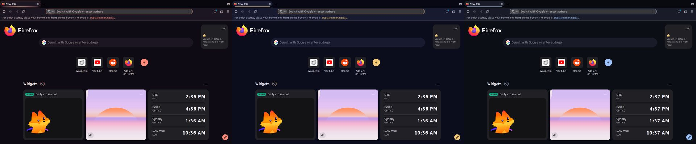

# Browsers

## Themes that follow Halcyon

Firefox and Chromium take the desktop's colours: a Halcyon theme's, or the wallpaper's when no theme is on. Applying
a theme, turning it off, or changing the wallpaper rewrites them. Browsers read their theme when they start, so a
browser that is open changes the next time you start it.

```sh
halcyon browsers                 # what is themed, and where
halcyon browsers update          # write them now
halcyon browsers off [firefox|chromium]
```

**Firefox** (and LibreWolf, Zen, Floorp, Waterfox): every profile gets `chrome/halcyon.css`, which colours the tab
strip, toolbars, address bar, menus and sidebar, and `chrome/halcyon-content.css` for the new tab and blank pages.
Both are pulled in with one `@import` line at the top of your `userChrome.css` and `userContent.css`. `user.js` gets
`toolkit.legacyUserProfileCustomizations.stylesheets`, without which Firefox ignores those files, and Firefox's dark or light base to match the palette, so its own text stays readable on Halcyon's colours. Your own rules in
those files stay as they are, and `off` removes only Halcyon's lines.

**Chromium**: a theme extension in `~/.local/share/halcyon/chromium-theme`, with the wallpaper on the new tab page.
Chromium and Brave load it from `~/.config/chromium-flags.conf` and `brave-flags.conf` (`--load-extension`, merged
with any you already have). Google Chrome stopped taking that flag, so load the folder once yourself:
`chrome://extensions` > *Developer mode* > *Load unpacked*. After that it follows like the others. Each change gets
a new version number, which is what makes Chromium rebuild the theme when it starts.



Turn either off in **Settings > Halcyon > Browsers**.

If Firefox doesn't change: close every Firefox window and start it again (it reads its theme only then), and check
`halcyon browsers` lists your profile as themed. Logging in, `update apply`, and applying a theme all write the
themes, so a profile made later is picked up too.

## USB devices in the browser

Sites that talk to hardware (flashing a keyboard or a microcontroller, updating a controller, a serial console) use
WebUSB, WebHID or Web Serial. When Chromium's device picker comes up empty, or a device is listed but "access denied",
the browser is fine: it isn't allowed to open the device.

```sh
halcyon usb                       # every device, whether the browser can open it, and what to do
halcyon usb allow 2341:0043       # let the browser open this one (ids as `halcyon usb` lists them)
halcyon usb allow --all           # every USB, HID and USB-serial device except keyboards and mice
halcyon usb remove                # undo
```

Why it happens on Arch:

| Cause | What `halcyon usb` says |
| --- | --- |
| USB device nodes (`/dev/bus/usb/…`) and `/dev/hidraw*` belong to root. systemd lets the person at the screen use only kinds of device it knows: sound, cameras, game controllers, security keys. | Which devices can't be opened, and the `allow` line for them. `allow` writes `/etc/udev/rules.d/70-halcyon-usb.rules`, which tags them `uaccess`: you get access while you're logged in at the screen, and nobody else does. |
| USB-serial adapters (`/dev/ttyUSB*`, `/dev/ttyACM*`) belong to the `uucp` group. | Join `uucp`, or `allow` the adapter. |
| A Flatpak browser sees no devices at all. | `flatpak override --user --device=all org.chromium.Chromium` |
| Your session isn't the active one on a seat (started over SSH, or with `su`). | Says so first: no device access is given then. |
| WebUSB never opens keyboards, mice and other HID, storage, sound, video or smart cards, on any system. | Names the device; sites reach HID devices through WebHID instead. |

`allow --all` leaves keyboards and mice out on purpose: raw access to them would let any program you run read what
you type. If a site still finds nothing, `chrome://device-log` in the browser says why it left a device out.
