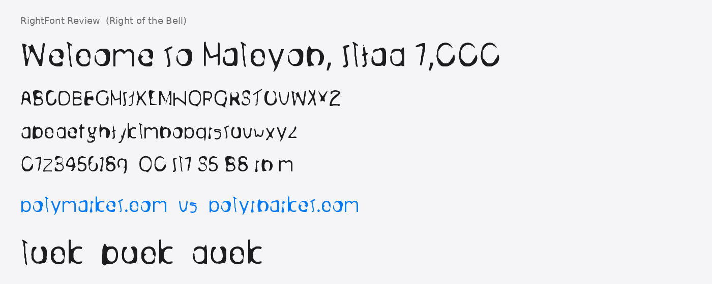

# Fonts

**Font Manager** (`font-manager`) comes with Halcyon: preview, install, enable and disable fonts, and keep
collections. `halcyon fonts manager` opens it.

`halcyon fonts install FILE...` installs font files (.ttf .otf .ttc .woff .woff2), or a zip of a family as a foundry
ships it, for your user in `~/.local/share/fonts/halcyon-imported`. Only the font files in a zip are taken, flattened
into one folder, so a zip can never write anywhere else. `halcyon fonts` lists them and `halcyon fonts remove NAME`
takes one away.

## RightFont

"The most confusing font possible", from Right of the Bell's video
[*I Made the Most Confusing Font Possible*](https://youtu.be/NTY_yunv2To). Every letter was graded against every
character in 1,600 fonts so that it still looks most like itself, but only just. You can probably read it. You can
also misread it.

Halcyon ships it as **RightFont Review** in `~/.local/share/fonts/halcyon-rightfont`, with its licence: it is made from
Inter and Open Sans and, like them, under the SIL Open Font License. `halcyon fonts install right-font` puts it back,
and `halcyon fonts install right-font --latest` fetches the newest version from
[rightofthebell.com/fonts](https://www.rightofthebell.com/fonts).
