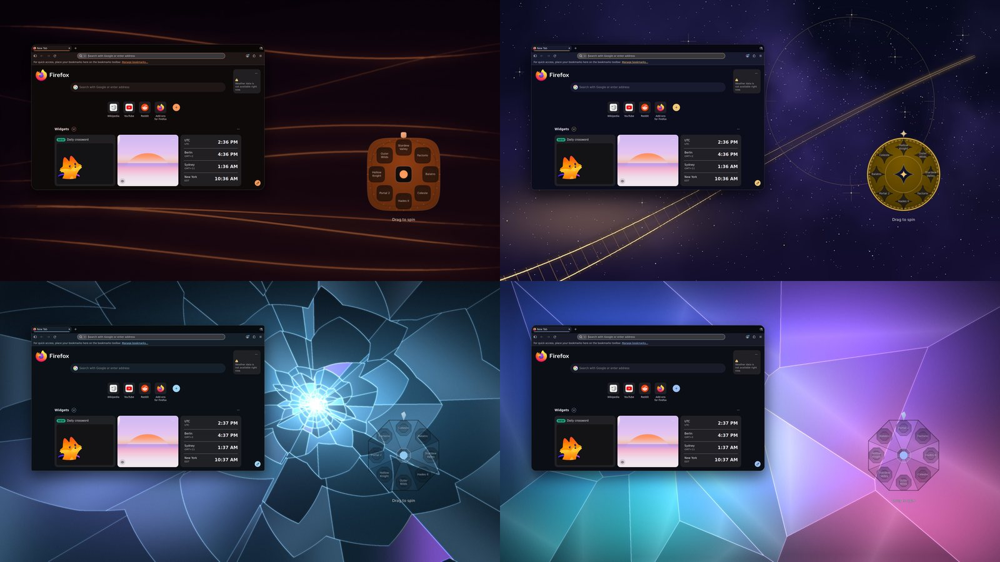
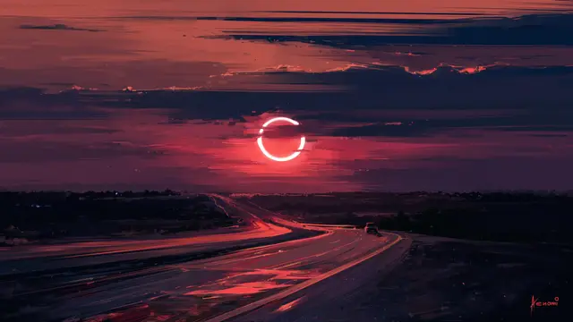
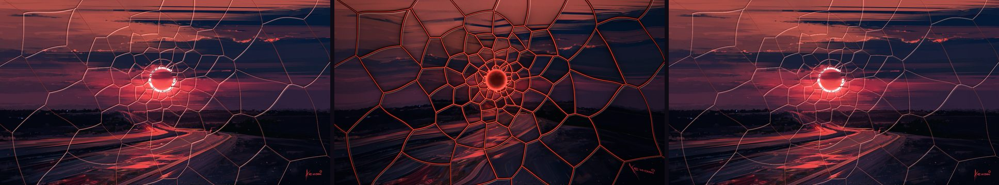
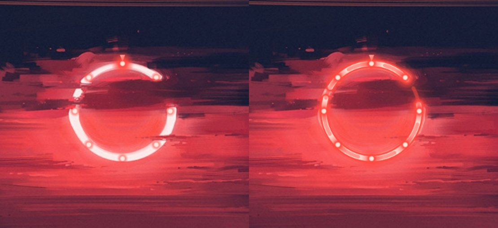
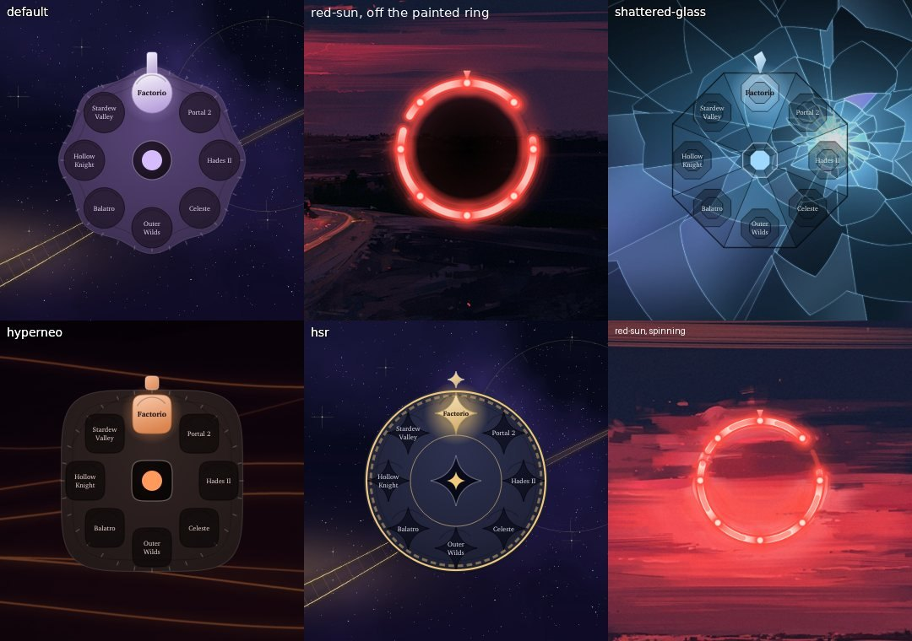
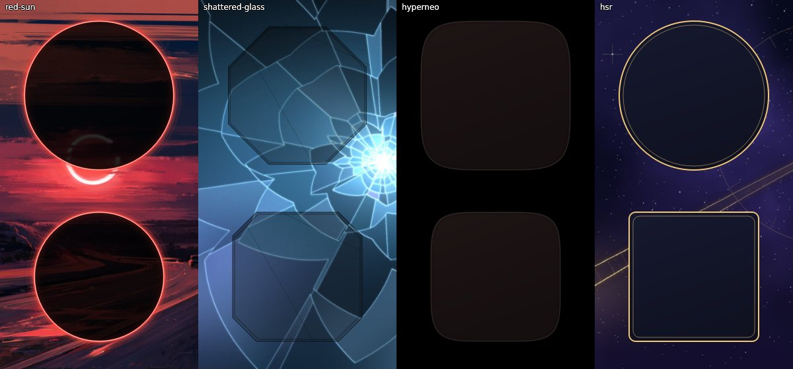

# Themes

By default, colours come from your wallpaper, as in upstream. A theme
replaces that with a palette designed by hand, plus its own window
style, animations, wallpaper and, for some, shell layout and effects:

| Theme | Id | Look |
|---|---|---|
| **HyperNeo** | `hyperneo` | macOS-style, in ember and neon on near-black. A menu bar and a dock, squircle windows with deep soft shadows, springy animations, rounded screen corners. |
| **Star Rail** | `hsr` | Astral gold and lavender on deep-space navy, over a golden rail curving through a nebula. Can show the current banner character. |
| **Shattered Glass** | `shattered-glass` | Liquid glass: a glass lens follows the pointer, clicks crack the screen, windows turn to frosted glass. Ice blue and prism violet, sharp corners. |
| **Fractured Glass** | `fractured-glass` | Refraction only, like Apple's Liquid Glass: a squircle glass lens follows the pointer and bends what's behind its rim. No ripples or cracks. Soft blue, lavender and pink over calm fragments of thick glass. |
| **Red Sun** | `red-sun` | A road at sunset under a red ring. Rose and ember accents over deep dusk violet, rounded windows with warm shadows. The ring is the revolver: spin it and the screen breaks, an eye opens in the sun and finds the car, and the tape rewinds. Wallpaper by Kenami, from Wallpaper Heaven. |



<sub>Top: HyperNeo, Star Rail. Bottom: Shattered Glass, Fractured Glass. Rendered from the repository: each theme's
wallpaper, its revolver drawn by the shell's own QML, and a real Firefox wearing the theme.</sub>

Pick one in **Settings > Halcyon**, with **`Ctrl + Super + Shift + T`**,
or from a terminal:

```sh
halcyon list
halcyon apply shattered-glass
halcyon off        # back to wallpaper colours
halcyon help       # everything else
```

`halcyon` is an alias in fish and zsh, and a link in `~/.local/bin`
(created when Hyprland starts) for other shells. Open a new terminal
after installing. Until then, the full path is
`~/.config/hypr/hyprland/halcyon/halcyon-theme`.

Applying prints one line. Output from upstream's colour scripts goes to
`~/.local/state/halcyon/apply.log` instead. On Hyprland that log
includes a traceback from end-4's KDE colour syncer
(kde-material-you-colors) about KWin not running. It's harmless: KWin is
KDE's compositor, and Hyprland is doing that job instead.

A theme recolours everything, not just the bar:

- **Shell:** its palette goes straight into the Quickshell colours.
- **Terminals:** its own 16-colour palette.
- **GTK, Qt/KDE, fuzzel and the lock screen:** generated from the theme's
  seed colour through upstream's own pipeline.
- **Windows:** gaps, corners, borders, blur, shadows and animations.
- **Shell layout:** some themes change shell settings too. HyperNeo turns
  on the dock and restyles the bar, and Shattered Glass makes panels more
  see-through. These are put back when you leave the theme, except any
  you changed yourself in the meantime.

Picking another wallpaper leaves the theme, and colours follow the new
wallpaper. The themes are dark themes, so switching to light mode, or
picking an accent colour, also leaves the theme. The colours are then
generated from the theme's accent, not hand-made. `halcyon off`
makes colours follow the wallpaper again.

### Applying a theme on a schedule

In Settings > Halcyon, open a theme's menu and choose **Auto-apply**. A theme can
come on at a clock time, at **sunset** or **sunrise** (with an offset, such as
30 minutes before sunset), on some days only, or with some weather. Wallpaper
Heaven suits sunset.

The sun times are worked out on this computer each day, for your location: the
one you type in the Auto-apply card, or else the bar's weather location. Where
the sun doesn't set that day, a sunset schedule doesn't fire.

```sh
halcyon auto list                   # what is scheduled, and today's sun times
halcyon auto sun                    # today's sunrise and sunset
halcyon auto location 51.51,-0.13   # set the location (clear: back to the weather's)
```

The **sun dial** in the bar, beside the clock, shows where the sun is in today's sky. Hover it for sunrise,
sunset, the length of the day and the next theme change your schedules will make ("Red Sun, today at 19:12 (30 min
before sunset), in 2 h 10 min"); click it to open Settings. `bar.sunDial: false` in the shell config hides it, and
`halcyon auto day` prints the same in a terminal. In the Halcyon themes the bar's groups are also edged in the
theme's own light: ember in Red Sun, gold in Star Rail, frost in the glass themes.

### Effects

| Level | What you get |
|---|---|
| `full` | Everything, including screen shaders. The glass themes' default. |
| `light` | No screen shader. Glass materials, translucent windows and animations stay. The other themes' default. |
| `off` | Plain blur, opaque windows, no native glass, stock animations. |

Set the level in **Settings > Halcyon > Effects**, from the
`Ctrl + Super + Shift + T` menu, or with:

```sh
halcyon effects light      # or full / off; sticks across themes
halcyon effects default    # back to each theme's own default
```

**Settings > Halcyon > Glass** tunes the glass. Changes apply to the
active theme straight away:

| Setting | Default | What it does |
|---|---|---|
| Pointer lens | on | The glass lens that follows the pointer (Full only) |
| Click ripples | on | A soft ripple and faint cracks where you click (Full only) |
| Colour fringe at screen edges | off | Slight colour split at the edges (Full only) |
| Strength | 0.5 | Scales all the screen effects; 0 turns them to nothing |
| Lens size | 90 px | Radius of the pointer lens |
| Lens bounce | 0.6 | How much the lens squashes and springs back; 0 turns it off |
| Focused / other windows | 0.96 / 0.9 | Opacity of glass windows (Light and Full) |
| Frost | 8 | Blur size behind glass windows |

They're stored under `halcyon` in `~/.config/illogical-impulse/config.json`,
which `halcyon refresh` re-reads.

**Red Sun at `full`**: the red ring in the wallpaper is the revolver. It sits on the painted ring, lights up while it
turns, and a real spin plays about ten seconds (`themes/shaders/red-sun.frag`):

1. **The sun spins.** The ring turns, gaps and all, smeared by its speed, with embers flying off it. Cracks run out
   from it and the screen splits into bevelled shards that sink towards it, the gaps glowing red, light raying out.
2. **An eye opens** in the hole inside the ring. It looks round, blinks, then fixes on the car on the road: its
   pupil narrows to a slit and a red ring closes on the car.
3. **It turns to videotape**: scanlines, colour bleeding sideways, tracking noise, and a VCR's `PLAY ▶` with a counter.
4. **It rewinds**: `◀◀ REW`, and everything runs backwards at speed through the tape's noise. The eye closes, the
   shards fly back together and the ring turns back, then `PLAY ▶` and the desktop is as it was.

A slow nudge does nothing. The shader is only switched in for those seconds (`halcyon collapse arm`, run by the
revolver, which also tells it where the car is on your screen), so Red Sun costs no GPU the rest of the time, unlike
the glass themes. At `light` or `off` the ring still turns, without the sequence. The revolver is on in every theme
(`halcyon revolver on|off`, or Settings > Revolver) and glows on the ring even at rest; `halcyon revolver status` says
why if it doesn't show. Turn off "In Red Sun, sit on the wallpaper's red ring"
there to keep the revolver where you placed it; it then draws the whole lit ring itself.







### The revolver, the clock and the weather card

The wallpaper widgets take the active theme's shapes. The revolver's drum is a Material cookie dial with no theme,
the red ring in Red Sun, a cut-glass disc with gem chambers in the glass themes, a squircle with icon-like chambers in
HyperNeo, and a gold rail with star chambers in Star Rail. The analogue clock's face and the weather card follow the
same shapes. Drag the drum to spin it: a flick fires the game under the hammer, a nudge only settles it.





**Shattered Glass at `full`** runs a screen shader
(`themes/shaders/shattered-glass.frag`) that treats the screen as a
pane of glass:

- **Pointer lens:** a liquid-glass lens follows the pointer. Its middle
  stays clear; light bends in its rounded rim, which catches a soft
  highlight on top and a faint shadow below. It fades when the pointer
  rests.
- **Click ripples:** each click sends a gentle ripple through the glass,
  with faint cracks around the click that heal as it passes.
- **Edges (off by default):** the screen's edges split colour slightly,
  as thick glass does.

Mouse effects need Hyprland's damage tracking off, so the screen is
redrawn every frame. That uses much more GPU than normal, so use `light`
on battery. The shader needs Hyprland 0.56 or newer. It has been
compile-checked and rendered offline, but not yet tried on a real
display. If the lens looks mirrored vertically,
`halcyon effects flip` fixes it.

**Fractured Glass at `full`** runs `themes/shaders/liquid-glass.frag`: a
lens shaped and lit like Apple's Liquid Glass controls. It is a squircle,
with an almost untouched middle and a rounded bezel that bends light more
and more towards the edge, so content wraps around the rim. The rim
catches light facing the top-left, with a dimmer reflection opposite and
a little colour in the inner bezel. The glass lifts saturation slightly
and sits on a soft shadow. Nothing reacts to clicks. Strength and lens
size come from Settings > Halcyon > Glass, like Shattered Glass; the
ripple and edge-fringe switches don't apply to it.

**Native glass.** Hyprland's development version, which comes after
0.56, adds built-in glass blur materials. When yours has them, HyperNeo and Shattered Glass switch to
the `acrylic` material automatically, which gives a curved, refracting
glass edge like macOS's Liquid Glass. On 0.56 they use tuned regular
blur instead.

**HyperNeo** has no traffic-light window buttons. Hyprland only draws
those through the hyprbars plugin, which isn't set up here.

**Lens bounce.** Both glass lenses are a little springy:
- **While moving:** the lens is pressed slightly flatter and quivers.
- **When the pointer stops:** it springs back past its rest shape, trading
  width for height a couple of times, then settles in about half a second.

Hyprland gives screen shaders the time since the pointer last moved, but
not its speed or direction, so the bounce follows that timing. It doesn't
lean into the direction of travel.

### Cursor

Halcyon has its own cursor, **Halcyon Glass**. It matches the glass
themes: a dark glass body, a white outline, a blue-to-lavender glint
inside the rim, and a soft shadow. There are 24 shapes (arrow, hand,
text, resize arrows, grab, zoom, and more), with an animated spinner for
busy and progress, covering 117 cursor names in all. It ships in both
formats: XCursor for X11/XWayland and GTK apps, and hyprcursor for
Hyprland itself.

It's on by default and follows any theme, including wallpaper colours.
Turn it off, or change its size, in **Settings > Halcyon > Cursor**, or:

```sh
halcyon cursor off        # back to illogical-impulse's Bibata cursor
halcyon cursor size 32
```

Every shape is drawn from scratch in `scripts/make-cursors.py`, which
rebuilds the theme into `dots/.local/share/icons/Halcyon-Glass`
(it needs cairosvg and Pillow).

### Banners (Star Rail)

The Star Rail theme can show a character on its wallpaper, in a
gacha-banner layout: the character on the right inside a gold frame, and
their name lower left. Point it at art you've saved:

```sh
halcyon banner hsr ~/Pictures/aventurine.png --title "Aventurine"
halcyon banner hsr ~/Pictures/pearl.jpg --title "Pearl" --subtitle "Version 4.6"
halcyon banner hsr --clear
```

- **Cut-out art:** a character with a transparent background stands full
  height on the right.
- **Full splash image:** it fills the right half and fades into the
  nebula.

If Star Rail is active, the banner updates right away.

No character art ships with this repository. It belongs to HoYoverse,
so it can't be released under this repo's GPL licence, and the banner
changes every few weeks anyway. Use art you've saved yourself, for
example the official wallpapers from the game's website.

### Making your own

Copy one of `dots/.config/hypr/hyprland/halcyon/themes/*.json`, rename it
and edit it. The file name is the theme's id. It needs:

- **Shell colours:** the full set, which `halcyon check` lists if
  any are missing.
- **Terminal colours:** 16 of them.
- **Seed colour and scheme:** for the generated app colours.
- **Window settings:** as in the existing themes.
- **Wallpaper:** a path relative to `themes/`, or starting with `~`.

Optional sections, all shown in the shipped themes:

- **More window settings:** squircle power, shadow shape, window opacity,
  `curves` and `animations`.
- **`effects`:** a default level, a screen shader, native glass settings.
- **`shell_config`:** any setting from the shell's `Config.qml`, written
  as dotted keys like `"dock.enable": true`.
- **`banner`:** frame and glow colours.

`halcyon check` rejects a theme with a missing key or a malformed
value, and one where any text colour falls below WCAG AA contrast (4.5:1)
on its background. CI also checks that every `shell_config` key exists
in the shell, and that shaders compile.

The theme wallpapers are procedural and original. No game assets are
used. `scripts/make-theme-wallpapers.py` redraws them.
